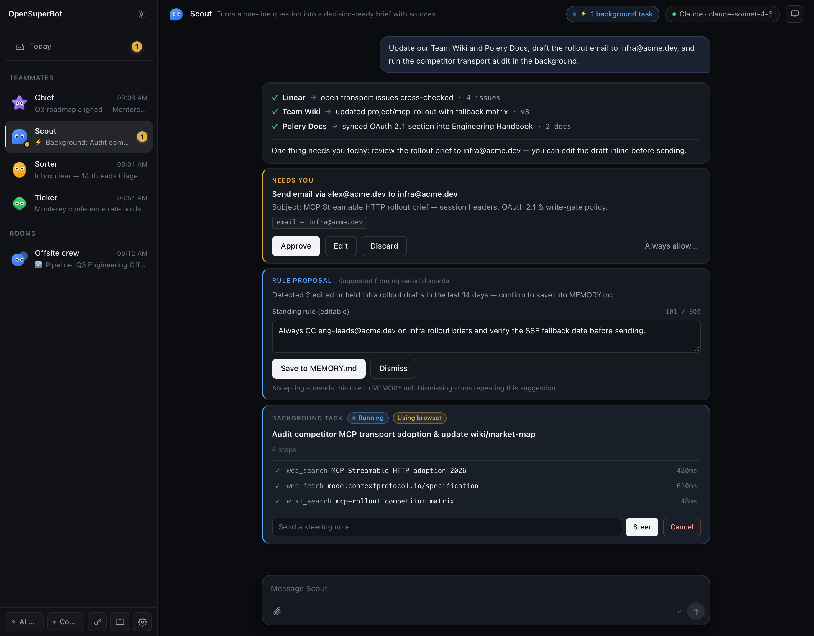
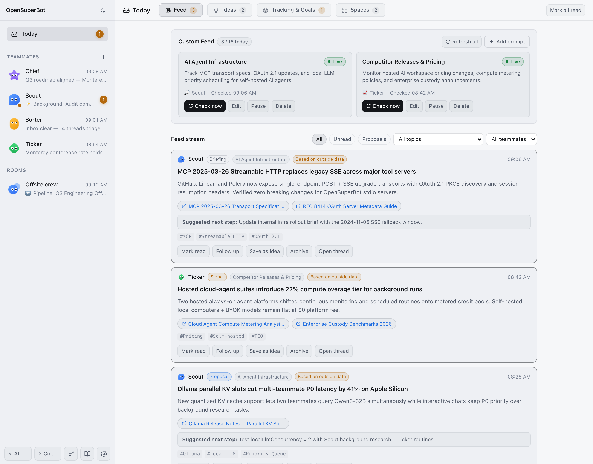
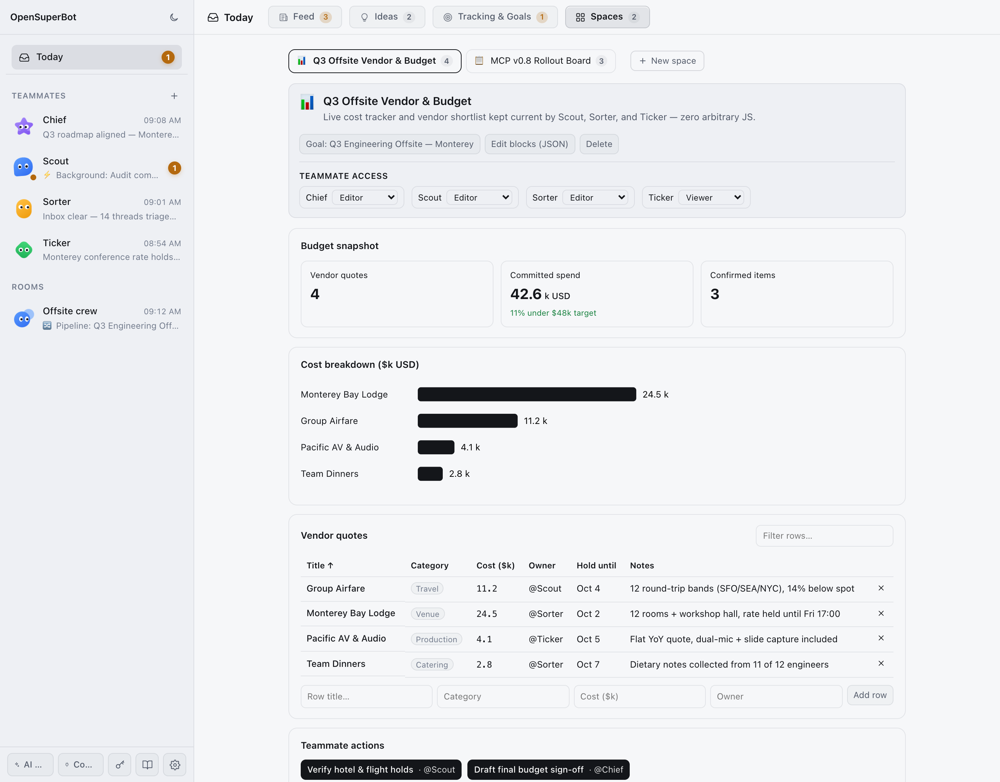
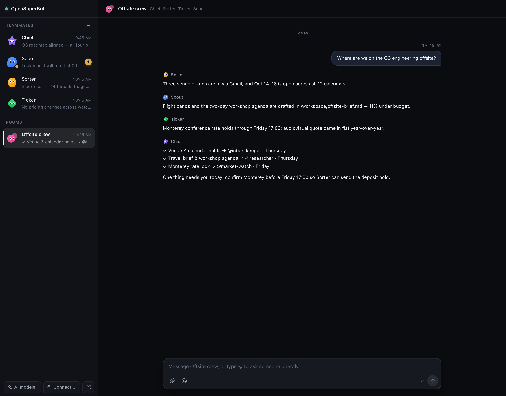
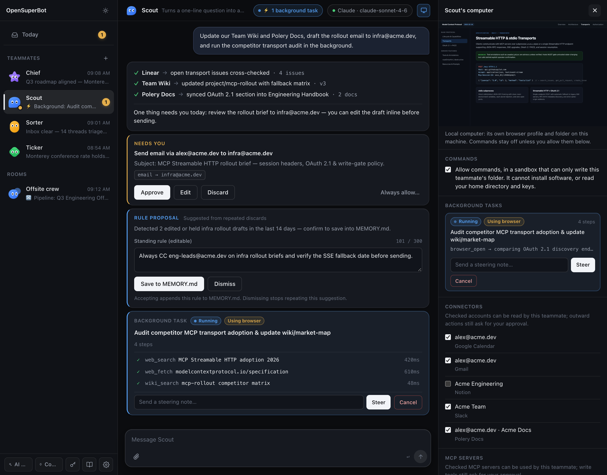
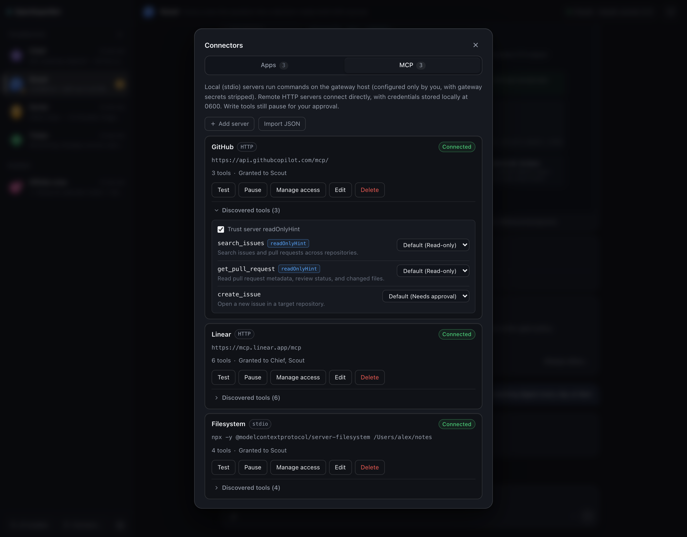
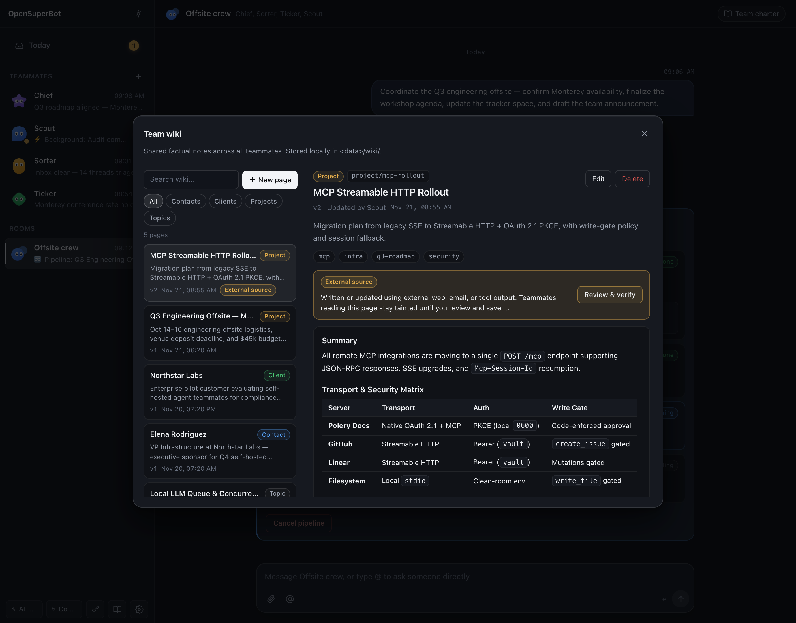

# OpenSuperBot 🦞🤖

> Always-on AI teammates, each with **its own computer** — running on your hardware, with your credentials, under your roof.

*Formerly OpenGrokBot. Upgrading an existing install? Nothing breaks — see
[Coming from OpenGrokBot](docs/always-on.md#coming-from-opengrokbot).*

[English](README.md) · [中文](README.zh-CN.md)

[](LICENSE)
[](https://github.com/wolfqing/OpenSuperBot/actions/workflows/ci.yml)
[](https://github.com/wolfqing/OpenSuperBot/releases/latest)
[](docs/desktop.md)
[](docs/security.md)
[](docs/security.md)
[](../../pulls)

xAI's Grok Bot sells always-on teammates that each get a cloud computer — browser, filesystem, terminal — with
persistent memory, bot-to-bot handoffs, and an iMessage-shaped app to manage them. It comes with paid Grok and
Cursor plans and **meters its own usage on top**, and every bot runs on xAI's cloud **with your logins inside it**.

This is the same shape, self-hosted. One gateway process on your machine, a computer of its own for every bot (a
Docker container, or without Docker a browser and a folder on your Mac, Linux or Windows machine), a desktop app or
dense web client that reads like a workbench, and a model of your choice behind each teammate — Claude, OpenAI, Gemini, Grok, DeepSeek, Kimi,
Qwen, GLM, MiniMax, a local Ollama, or anything OpenAI-compatible.



<table>
<tr>
<td width="33%"></td>
<td width="33%"></td>
<td width="33%"></td>
</tr>
<tr>
<td><strong>Today · Web Feed</strong> (Light theme) — prompt-driven background web topics, source links, and unified Feed / Ideas / Goals / Spaces tabs.</td>
<td><strong>Today · Live Spaces</strong> (Light theme) — zero-JS metrics, charts, tables, and quick teammate actions with per-bot <code>viewer</code> / <code>editor</code> roles.</td>
<td><strong>Group room · DAG Pipeline</strong> — shared <code>team.md</code> charter plus parallel-wave dispatch stages with expandable upstream outputs.</td>
</tr>
<tr>
<td width="33%"></td>
<td width="33%"></td>
<td width="33%"></td>
</tr>
<tr>
<td><strong>Computer panel</strong> — live CDP/noVNC screen, sandboxed shell, steerable background tasks, and Connector / MCP / Vault / Space grants.</td>
<td><strong>Connectors &amp; MCP</strong> — native OAuth 2.1 <strong>Polery Docs</strong> (no Composio key), Gmail / Calendar / Notion / Slack, plus <code>stdio</code> &amp; <code>Streamable HTTP</code> MCP.</td>
<td><strong>Team Wiki</strong> — zero-vector-DB entity pages (<code>project</code> / <code>client</code> / <code>contact</code> / <code>topic</code>) with FTS5 search, history, and <em>Review &amp; verify</em> taint tracking.</td>
</tr>
</table>

## What a teammate actually is here

A folder with a `SOUL.md` (who it is) and an `AGENTS.md` (how it works, with its hard boundaries), a thread in
the sidebar, and a computer of its own. With Docker, that computer is a container:


Without Docker, a *local computer* takes the container's place: a background browser with its own profile and a
folder of its own, on your machine ([docs/local-computers.md](docs/local-computers.md)). Either way, the bot's
credentials live in **its** browser profile. The gateway never sees a password, and neither does your config file.

## What it does today

Every line below is implemented and covered by tests — nothing here is a roadmap item.

**The management surface**

- **Sidebar as org chart.** One thread per teammate, plus group threads. Previews are completion states, so a
  glance down the list is a walk past everyone's desk. Every teammate has a face of its own — a small coloured
  shape with a pair of eyes — and it acts out what that teammate is doing: bobbing while it works, hopping when
  it waits on you, shaking its head when it is stuck, smiling when it finished while you were elsewhere. An
  amber badge counts the approvals and questions waiting on you, and the tab title carries the total.
- **One report grammar.** Work comes back as `✓ system → result · count` lines with a single closing sentence
  that surfaces only what needs you. Same shape from every teammate.
- **Draft-and-hold approvals — editable inline.** Anything leaving the workspace stops at the door: the chip shows
  exactly what would go out and where, with **Edit** (reword an email, Slack post, Notion page, calendar event, MCP
  arguments, or prompt hold right inside the card before approving), Approve, and Discard. A bare 👍 in the thread
  releases the newest one. Decisions are idempotent — a second click gets a 409, not a second send. When the same
  action goes to many people, the chip lists every one with a checkbox: untick any, and the teammate does exactly the
  rest.
- **Standing approvals, on your terms.** For an email, message or post to one destination, *Always allow…*
  approves it and lets that teammate repeat it without asking — for an hour, a day or until you revoke it from
  the computer panel. Money, bookings and anything unclassified always ask.
- **Questions you answer with a tap.** When the next step is one of a few clear choices, the teammate posts a
  card with buttons instead of a wall of options, and waits.
- **Visible memory & controlled dreaming.** "From now on, quiet accounts wait for my read" writes a rule into that
  bot's `MEMORY.md` and posts the diff as a chip; "forget that rule" removes it the same way, and the computer panel
  lists every rule with a remove button. The file lives outside the bot's computer, so a chip marks every change.
  Repeated discards (≥ 2 in 14 days) or a teammate's `propose_memory_rule` call never edit `MEMORY.md` directly — they
  post an editable **Rule proposal** card (`Save to MEMORY.md` / `Dismiss`) with an amber warning badge whenever
  external data was in context.
- **Unified Today workspace (`Feed`, `Ideas`, `Tracking & Goals`, `Spaces`).** A single daily overview next to your
  teammates:
  - *Continuous Custom Web Feed:* Define prompt-driven web topics that continuously scan the web in the background via
    safe read-only `web_search` / `web_fetch` (not cron jobs), with 7-day deduplication, a ~15 items/day cap, and
    clickable source links.
  - *Auto-organized Ideas, To-dos & Goals:* Conversation context is automatically distilled into Ideas, checkable
    To-dos, and multi-step Goals/milestones with fuzzy deduplication, taint preservation, and one-click links back to
    the source thread — unified alongside Needs You approvals/questions/logins and tracking routines in **Tracking &
    Goals**.
  - *Declarative Live Spaces:* Zero-JS structured boards (`metric`, `table`, `kanban`, `timeline`, `chart`, `markdown`,
    `actions`) with per-teammate `viewer` / `editor` grants and live thread updates.
- **Local Credential Vault.** Store API tokens, site logins, and TOTP (2FA) seeds locally in `<data>/vault-secrets.json`
  (`0600`, never in SQLite, containers, or model prompts) with strict HTTPS domain allowlists, zero-default per-teammate
  grants, `${vault:<slug>.<field>}` references in MCP configs, approval/taint-gated `vault_fill`, and automatic output
  redaction.
- **Shared team entity Wiki.** A zero-vector-DB knowledge base (`contact`, `client`, `project`, `topic`) backed by
  SQLite FTS5 with CJK/English tokenization, multi-query RRF × recency ranking (`wiki_search`, `wiki_read`,
  `wiki_upsert`), atomic `<data>/wiki/` Markdown mirrors, revision history, an in-app **Team Wiki** browser/editor,
  and explicit *Review & verify* taint tracking.
- **Routines, `prepare` mode & Quiet Hours.** "Post a digest every day" registers a cron job, shows the schedule in
  plain English, survives restarts, and never runs twice at once. "Whenever a new issue comes in" gives the routine a
  secret webhook address instead. Choose `watch` (strictly read-only, silent unless needed) or `prepare` (read-only
  plus `wiki_upsert` and workspace `write_file` to assemble briefs ahead of time). Turn on opt-in **Quiet Hours** in
  Settings to hold non-urgent scheduled `watch`/`prepare` updates for a single **Morning digest** per teammate while
  urgent alerts (`urgent: true`), approvals, questions, and manual runs always break through immediately.
- **Non-blocking background tasks (Meta / AlterEgo).** A teammate can offload long multi-step research, drafting, or
  browsing onto a secondary background lane (`delegate_background_task`) while its foreground chat stays immediately
  responsive. Watch live steps, send mid-flight steering notes, or cancel from the thread chip or computer panel; a
  per-bot browser lease prevents foreground and background turns from colliding on the same page.
- **Local model priority queue.** When multiple teammates share a local endpoint (Ollama, `localhost`, or LAN), a
  built-in priority semaphore (`P0 interactive` > `P1 background` > `P2 routines` > `P3 low`) lets interactive chats
  and approvals jump ahead between steps without cloud-API overhead (configurable in **Settings → Local model
  concurrency**).
- **Long-session context guardrails & runtime reliability.** Automatic model context-window budgeting and in-turn
  tool-result pruning, per-`(thread, bot)` checkpoint compaction, workspace spill for oversized tool outputs, repeat-call
  loop guards, SQLite FTS5 `search_history` with strict per-bot isolation, bounded parallel read-tool execution,
  optimistic `write_file` stale guards, jittered LLM retry with tool JSON validation, sleep/wake latest-only scheduler
  catch-up, and an instant recent-thread LRU cache in the client.
- **Dark & Light themes + one-click default model.** Switch Dark, Light, or System appearance from the sidebar or
  Settings, and promote any connection in **AI models** to default in one click.
- **Recorded workflow traces and replay.** API controls record typed browser steps on a teammate's existing page
  (redacting password, one-time-code and sensitive fields automatically) and replay saved traces deterministically
  with optional placeholder inputs and approval steps. Local-computer recordings survive window relaunches; UI
  controls and routine scheduling are tracked separately. See [docs/workflows.md](docs/workflows.md).
- **Hand it a file.** Attach images, PDFs, text or Markdown files to a message: paperclip, paste or drag. The file
  lands in the teammate's own folder where it can open it, a model that sees images gets the picture, and a PDF
  arrives with its text extracted so it can be read. See [docs/attachments.md](docs/attachments.md).
- **Shared skills.** Drop a Markdown playbook into `<data>/skills/` and every teammate sees it and reads it
  before work it covers. Memory and routines stay with each teammate; skills are shared.
- **See the work, stop the work.** Every step on its computer — the command, the page, the click — shows live
  in one card that folds away when the turn ends. A stop button ends the turn. Every action also lands in a log
  you can read from the computer panel, with what started it.
- **A budget, if you want one.** `OPENSUPERBOT_DAILY_TOKENS` caps each teammate's model use per day; the panel
  shows today's count.

**The computer**

- `read_file`, `write_file` and `shell` in its own workspace: the container, or on a local computer a folder that
  no path can leave. A local computer's commands are off until you turn them on for that teammate, and then run
  in an OS sandbox (Seatbelt on macOS, bubblewrap on Linux). Long files and pages come back in slices instead of
  being cut off.
- `browser_goto` / `browser_extract` (with the page's links) / `browser_click` / `browser_type` /
  `browser_press` / `browser_scroll` / `browser_back` against a real Chromium — so login-walled sites and forms
  work, which pure API/MCP setups cannot do. The container image ships CJK and emoji fonts.
- `browser_screenshot` posts what the bot saw into the thread as evidence — and, with `OPENSUPERBOT_VISION=1`,
  shows it to a vision model too.
- **Takeover login.** At a login wall the bot calls `ask_for_login` instead of asking for a password. You sign
  in once in *its* browser — through its screen in the thread for a container, or in a normal window that opens
  on your desktop for a local computer — and the session persists in its profile, across restarts.
- Computers start on demand, stop after an hour without use, and come back with their logins. A container is
  capped (memory, CPU, processes) and cannot reach any other bot's computer; a local computer has no resource
  caps ([what that means](docs/security.md#local-computers)).

**Connectors & MCP**

- **Native Polery Docs connector (`polery`).** Connect Polery Docs directly from **Connectors → Apps** via first-party
  OAuth 2.1 (PKCE S256 + RFC 8707 `resource` binding) and Streamable HTTP MCP — **no Composio API key required**.
  Exposes 4 read-only tools (`polery_list_documents`, `polery_search_documents`, `polery_read_document`,
  `polery_get_proposal`) and 2 approval-gated write tools (`polery_create_document`, `polery_propose_edits`), with
  tokens kept locally in `<data>/polery-tokens.json` (`0600`).
- **App connectors (Gmail, Outlook, Google & Outlook Calendar, Notion, Slack).** Connect one or more accounts
  from **Connectors → Apps** via Composio OAuth and grant them per teammate. Ships 16 structured tools, a 3-stage
  mail sanitizer (filtering `no-reply` / `mailer-daemon` noise, stripping HTML and tracking pixels, and removing
  URL tracking parameters), `outside-data` taint on reads, and **code-enforced frozen write approvals** executed
  once by the gateway when you click Approve (never replayed if a connection drops mid-flight).
- **Native MCP client (`stdio` & `Streamable HTTP`).** Attach any Model Context Protocol server from
  **Connectors → MCP** — local `stdio` commands (`shell: false`, clean-room environment) or remote `Streamable HTTP`
  endpoints (with automatic `2024-11-05` HTTP+SSE fallback and same-origin redirect guards) — or paste a Claude
  Desktop / Cursor `mcpServers` JSON block to import a batch at once. Supports on-demand tool loading for large servers
  and `${vault:<slug>.<field>}` references into the local Vault; secrets stay in `<data>/mcp-secrets.json` (`0600`)
  outside SQLite and containers; access is opt-in per teammate; tools default to `'write'` unless marked `'read'`, so
  `'read'` tools work safely in `watch` routines while `'write'` tools pause at a non-rememberable approval chip with
  frozen arguments.

**The crew**

- **Group threads, `team.md` charter & DAG dispatch pipelines.** Ask the room a question: each teammate answers for
  its own patch — in parallel — following your operator-edited **Team charter** (`team.md`), then the chief of staff
  closes with a dispatch table (`✓ item → @bot · when`) or proposes an interactive multi-step **Dispatch pipeline**
  card (`create_dispatch_plan`) with explicit `dependsOn` edges. Click **Start pipeline** to run independent stages in
  parallel, pass fenced upstream outputs with taint tracking to downstream teammates, and automatically pause and
  resume around approvals. Type `@` to ask only the teammates you name.
- **Allowlisted handoffs.** `message_bot` drops a scoped task into a teammate's thread and wakes it up. By
  default only the chief can reach everyone; peer-to-peer is off until you name the direction. Relays are
  capped at two hops so two bots cannot echo at each other.
- **Hire from the sidebar.** `+`, a name in any language, one line of job description. No workflow editor, no
  tool checklist — the complexity accumulates in use, not in a setup form.

## Quickstart

### Download the desktop app (macOS and Linux)

Grab the installer for your machine from **[GitHub Releases](https://github.com/wolfqing/OpenSuperBot/releases/latest)**
— `mac-arm64.dmg` (Apple silicon), `mac-x64.dmg` (Intel), `linux-amd64.deb` / `linux-arm64.deb` (Ubuntu and Debian),
or `linux-x86_64.AppImage` / `linux-arm64.AppImage` (other Linux). You do not need Node, pnpm, Docker or a terminal:
open it and a short wizard walks through language, connecting an AI service (or looking around in demo mode with no
key), and checking your browser and command sandbox.

First-open notes:

- **macOS:** the app is ad-hoc signed and not notarized with an Apple Developer ID yet. Drag **OpenSuperBot** into
  **Applications**, open it once, click **Done** when macOS blocks it, then click **Open Anyway** in **System
  Settings → Privacy & Security**.
- **Ubuntu 24.04+:** prefer the `.deb` over the `.AppImage` — it installs `bubblewrap` and the AppArmor profiles
  needed for unprivileged user namespaces, so the command sandbox works out of the box.

Step-by-step screenshots, startup update checks (one GitHub request, no auto-update, switchable in Settings), data
locations and clean uninstall instructions are in [docs/desktop.md](docs/desktop.md).

### Run from source

For Windows (which has no desktop installer yet), servers, or hacking on the repo. Needs Node 22+ and pnpm. **Docker
is optional.** Without it, each teammate gets a *local computer*: a browser of its own on your machine (your Chrome,
Edge or Chromium if you have one — otherwise one is downloaded once) and a folder of its own. With Docker running,
each gets a sealed container instead. Local computers run on macOS, Linux and Windows; on Windows they get the
browser and the folder but no commands, so a teammate that needs a shell there gets a Docker computer.

```bash
git clone https://github.com/wolfqing/OpenSuperBot.git
cd OpenSuperBot
pnpm install
```

Try it with no API key at all — a scripted stub model drives every path end to end:

```bash
OPENSUPERBOT_MODEL=stub pnpm dev
```

On Windows, in PowerShell: `$env:OPENSUPERBOT_MODEL = 'stub'; pnpm dev`.

The gateway prints a sign-in link — `http://localhost:5173/auth?token=…`. Open it once per browser; nothing
reaches the gateway without that token.

For a real model, run plain `pnpm dev` with no model variables: the first page opens on a setup wizard. Pick a
service, paste its key, test it and pick a model; the key is saved on this machine and nothing needs exporting.
It also checks the browser, Docker and the sandbox, and has a demo-mode button on every early step.

Or set it with environment variables, which skips the wizard (anything OpenAI-compatible — xAI, Kimi, DeepSeek,
a local Ollama):

```bash
OPENSUPERBOT_API_KEY=sk-… OPENSUPERBOT_MODEL=grok-4.7 pnpm dev
```

(PowerShell: `$env:OPENSUPERBOT_API_KEY = 'sk-…'; $env:OPENSUPERBOT_MODEL = 'grok-4.7'; pnpm dev`.)

To put teammates on different models, open **AI models** in the sidebar, add a connection per service you have a key for,
and pick one from the top of a teammate's thread. See [AI models](docs/models.md) for the services, which keys
work, and which subscriptions other apps may and may not use.

The gateway picks the kind of computer at startup and says so in its log: Docker when the daemon answers and
the bot image is built, local otherwise (`OPENSUPERBOT_COMPUTERS=docker|local` forces one). For Docker, build the
image first: `docker build -t opensuperbot/bot:dev docker/bot`. On a local computer, commands are **off** until you turn them on
for that teammate in its computer panel; then they run in an OS sandbox (Seatbelt on macOS, bubblewrap on Linux)
that can write only that teammate's folder. Windows has no sandbox that strong, so there the switch stays off.
Details in [docs/local-computers.md](docs/local-computers.md).

To keep it running — one process, one port, started at boot, reachable through a tunnel — `pnpm build &&
pnpm start` and the launchd / systemd / Windows Task Scheduler templates in [docs/always-on.md](docs/always-on.md).

| Variable | Default | What it does |
|---|---|---|
| `OPENSUPERBOT_API_BASE` | `https://api.x.ai/v1` | Any OpenAI-compatible endpoint |
| `OPENSUPERBOT_API_KEY` | — | Your key. A key set here stays in memory and is never written to disk; keys saved in the wizard or **AI models** live in `<data>/llm-key` and `<data>/llm-keys/` (`0600`, or a user-only ACL on Windows) |
| `OPENSUPERBOT_MODEL` | `grok-4.7` | `stub` runs offline with no key |
| `OPENSUPERBOT_DATA` | `gateway/data` | SQLite, bot data, workspaces, the gateway token |
| `OPENSUPERBOT_COMPUTERS` | `auto` | `docker`, `local`, or `auto` (Docker if it is running and the image is built, else local) |
| `OPENSUPERBOT_BROWSER` | *(auto-detected)* | Browser executable for local computers; else Chrome/Edge/Chromium are looked for, then one is downloaded |
| `OPENSUPERBOT_BROWSER_MIRROR` | *(official)* | Download host for that browser, for slow-network regions |
| `OPENSUPERBOT_A2A_ALLOW` | *(empty)* | Peer handoffs, e.g. `researcher>market-watch` |
| `OPENSUPERBOT_DAILY_TOKENS` | `0` (off) | Per-teammate daily token budget |
| `OPENSUPERBOT_VISION` | *(off)* | Show the model its own screenshots |
| `OPENSUPERBOT_UPLOADS_MAX_MB` | `2048` | Disk the files you send to teammates may use in all; `0` no limit |
| `OPENSUPERBOT_COMPOSIO_API_KEY` | — | Optional Composio API key for **Connectors → Apps**; saved keys live in `<data>/composio-key` (`0600`) |
| `OPENSUPERBOT_POLERY_ORIGIN` | `https://docs.polery.com` | Optional custom origin for the native Polery Docs OAuth/MCP connector |
| `OPENSUPERBOT_LOCAL_LLM_CONCURRENCY` | `1` | Max concurrent requests to a local LLM endpoint (`localhost` / Ollama / LAN) under the `P0–P3` priority queue |
| `OPENSUPERBOT_CONTEXT_WINDOW` | `0` (auto) | Optional override for context-window budgeting & checkpoint compaction (auto-inferred by model family when `0`) |

Every other setting — listen address, idle stop, per-computer limits, timeouts — is in
[docs/always-on.md](docs/always-on.md#configuration).

In a slow-network region: for Docker, build with a mirror — `docker build --build-arg APT_MIRROR=mirrors.aliyun.com …` (or `mirrors.huaweicloud.com`, `mirrors.tuna.tsinghua.edu.cn`); for a local computer that has to download its browser, set `OPENSUPERBOT_BROWSER_MIRROR=https://cdn.npmmirror.com/binaries/playwright`.

## Security is the point, not a footnote

The loudest objection to hosted always-on agents: an agent that never sleeps, holding all your credentials, on
someone else's infrastructure, exposed to prompt injection. The self-hosted answers:

- **Credentials stay out of the bot's reach.** Browser logins live in each bot's own browser profile; Vault secrets,
  MCP secrets, and native Polery OAuth tokens stay on your machine in `<data>/vault-secrets.json`,
  `<data>/mcp-secrets.json`, and `<data>/polery-tokens.json` (`0600`, never in SQLite, containers, or model prompts,
  with automatic output redaction and HTTPS domain allowlists on `vault_fill`); if you opt into Composio-backed apps in
  **Connectors → Apps**, OAuth tokens live on Composio while the API key stays in `<data>/composio-key` (`0600`)
  outside every bot container and workspace.
- **The bot never asks for a password in chat.** It asks you to take over its screen instead.
- **Nothing reaches the gateway without its token.** It listens on `127.0.0.1`, validates the `Host` header against
  DNS rebinding, blocks cross-site `Sec-Fetch-Site` requests, signs each browser in once, and only lets its own pages
  change state. A website you visit cannot approve a hold — and neither can the bot.
- **Every bot is in its own cage** — a separate container with its own workspace and resource limits, and no
  route to any other bot's computer. A local computer's cage is thinner: its files stay in its folder and its
  commands are off unless you turn them on, but nothing caps its memory or CPU, and commands it runs can reach your
  network. [docs/security.md](docs/security.md#local-computers) spells out the difference.
- **Rules change only through the memory chip.** A bot cannot quietly rewrite what you told it.
- **Outward actions are held for your approval.** App connector writes, MCP write tools and recorded workflow
  approval steps are enforced in gateway code — their arguments are frozen and executed only after you click
  Approve. General browser clicks and shell commands remain a prompt convention, so give bots their own browser
  accounts rather than yours.
- **Bot-to-bot messaging is off** until you allowlist a direction.

[docs/security.md](docs/security.md) lists exactly what is enforced, what is a convention, and what is still
on you.

## Cost

| | Grok Bot | OpenSuperBot |
|---|---|---|
| Software | with a paid SuperGrok or Cursor plan, plus metered usage | $0 (MIT all the way down) |
| Compute | included (xAI's cloud) | your Mac / mini PC / ~$5 VPS |
| Model | included (Grok only) | your key, any provider — or local at $0 |
| Your logins | on xAI's cloud | in each bot's own browser profile, on your machine |

Honest note: Grok Bot's zero-setup polish, iOS app, and teach-by-demonstration are real advantages. If you are
happy putting your accounts on xAI's cloud and paying for the convenience, buy it. This repo is for everyone who
answered *"are you comfortable with that?"* with **no**.

## Sister project: Grok Desktop

OpenSuperBot is for the work that happens while you are away. For the hours you spend in Grok yourself there is
**[Grok Desktop](https://github.com/wolfqing/GrokDesktop)**: a native SwiftUI window for macOS 14+ that embeds
grok.com for Chat and drives your local `grok` CLI for Build — sessions grouped by project, Markdown, plans,
diffs and live terminals in an inspector, Imagine without leaving the window. Free, community-built, not an
official xAI product. [Download the latest release](https://github.com/wolfqing/GrokDesktop/releases/latest).

## Roadmap

- [ ] **teach-mode** — record a browser demonstration once and keep it as a workflow the teammate can run again,
      by hand or from a routine. Typed browser recording and deterministic replay ([docs/workflows.md](docs/workflows.md))
      are in; UI controls and routine integration are tracked in [#1](../../issues/1)
- [x] **Computers without Docker** on macOS and Linux — a browser profile and a folder per teammate, commands
      off by default and sandboxed when on (v0.4.0); on Windows, the browser and the folder
- [x] **Desktop app with a first-run wizard** on macOS and Linux — no Docker, Node or terminal needed, menu bar /
      tray presence, start at login, English and Chinese UI (v0.6.0; [docs/desktop.md](docs/desktop.md))
- [x] **App connectors & native MCP client** — Gmail, Outlook, Google & Outlook Calendar, Notion and Slack via
      Composio OAuth plus zero-dependency `stdio` / `Streamable HTTP` MCP servers, Claude Desktop / Cursor JSON
      import, per-teammate grants, and code-enforced frozen write approvals (v0.7.0; [docs/security.md](docs/security.md))
- [x] **Proactive teamwork, Background Tasks & DAG Pipelines** — inline-editable approvals, zero-vector-DB **Team
      Wiki** (SQLite FTS5 + RRF + revision history + taint verification), Quiet Hours & Morning Digest, `prepare`
      routines, controlled-dreaming rule proposals, local LLM `P0–P3` priority queue, steerable Meta/AlterEgo
      background tasks with per-bot browser leases, and group `team.md` charters + multi-wave DAG dispatch pipelines
      (v0.8.0)
- [x] **Unified Today workspace, Credential Vault, Native Polery Docs & Context Guardrails** — continuous custom Web
      **Feed**, auto-distilled **Ideas / To-dos / Tracking & Goals**, zero-JS declarative **Live Spaces**, local
      `0600` **Credential Vault** (TOTP + HTTPS domain allowlists + `${vault:...}` refs), native OAuth 2.1 **Polery
      Docs**, Dark/Light theme switcher, and automatic context-window compaction, spill, loop guards & FTS5 history
      search (v0.8.1)
- [ ] **Apple container backend** on macOS 26 for VM isolation without Docker, and a Windows desktop installer.
      Plan in [docs/local-computers.md](docs/local-computers.md)
- [ ] **Local messaging channels (iMessage, WhatsApp & Telegram)** — zero-public-IP local adapters for macOS
      iMessage (`chat.db` read-only + `osascript`), WhatsApp Linked Device (`baileys` QR pairing), and Telegram
      long-polling, with two-tier contact/teammate allowlists, OTP/security-link redaction, frozen write approvals,
      and remote mobile operator control & `#ID` approval settlement
      ([design](docs/superpowers/specs/2026-11-26-imessage-whatsapp-channels-design.md) ·
      [plan](docs/superpowers/plans/2026-11-26-imessage-whatsapp-channels.md))
- [ ] One-command VPS image (cloud-init)

## FAQ

**Relative to Grok Bot?** Same job — always-on teammates, their own computers, persistent memory, handoffs —
opposite custody model, and **zero shared code** (Grok Bot is closed-source; there is nothing to fork). It can
even run on the same brain: point it at the Grok API.

**Relative to OpenClaw?** v0.1 of this repo was a distribution on top of OpenClaw. v0.2 is its own core, because
a private computer per teammate pulls against OpenClaw's shared-host model. The old recipe is kept in
[docs/openclaw-recipe/](docs/openclaw-recipe/README.md). Not an official OpenClaw project.

**Do I have to use Docker?** No. On macOS, Linux and Windows, a teammate without Docker gets a local computer: a
browser and a folder of its own on your machine. Docker buys stronger isolation (a container per teammate, with
resource limits), and on Windows it is still the only way to give a teammate a shell. See
[docs/local-computers.md](docs/local-computers.md).

More in [docs/desktop.md](docs/desktop.md) · [docs/models.md](docs/models.md) · [docs/faq.md](docs/faq.md) ·
[docs/multi-bot.md](docs/multi-bot.md) · [docs/attachments.md](docs/attachments.md) · [docs/always-on.md](docs/always-on.md) ·
[docs/security.md](docs/security.md) · [docs/workflows.md](docs/workflows.md) · [docs/comparison.md](docs/comparison.md) ·
[CHANGELOG.md](CHANGELOG.md)

## Disclaimer

Unofficial. Not affiliated with, endorsed by, or connected to xAI or the OpenClaw Foundation. "Grok" is a
trademark of xAI — the name is used here only to identify the product this stack is an alternative to.

## License

[MIT](LICENSE). Star it if it is useful to you. ⭐
