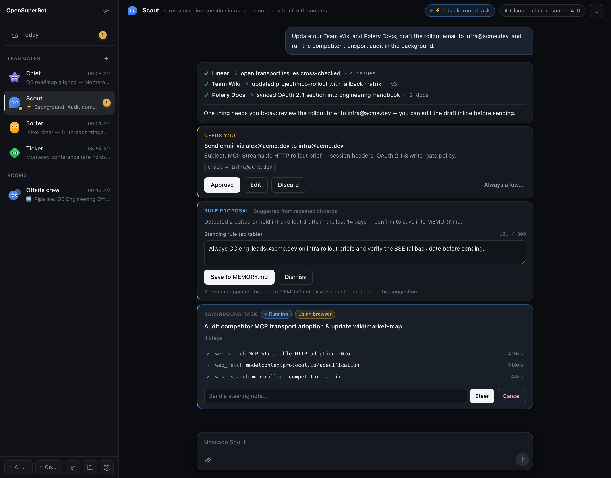
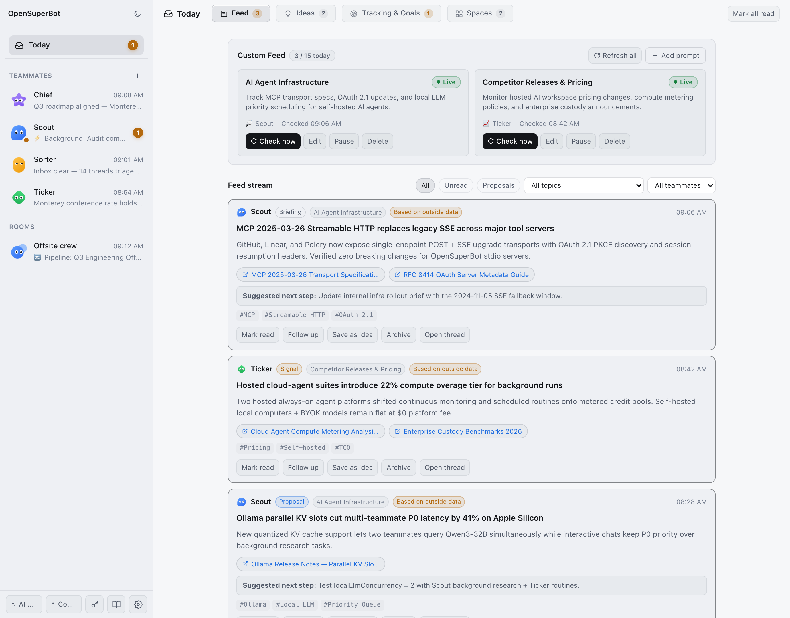
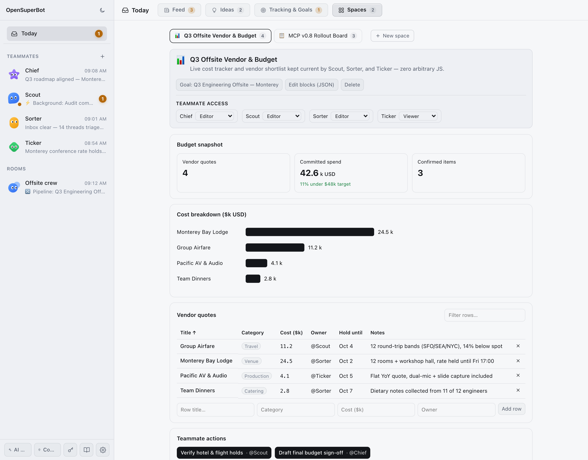
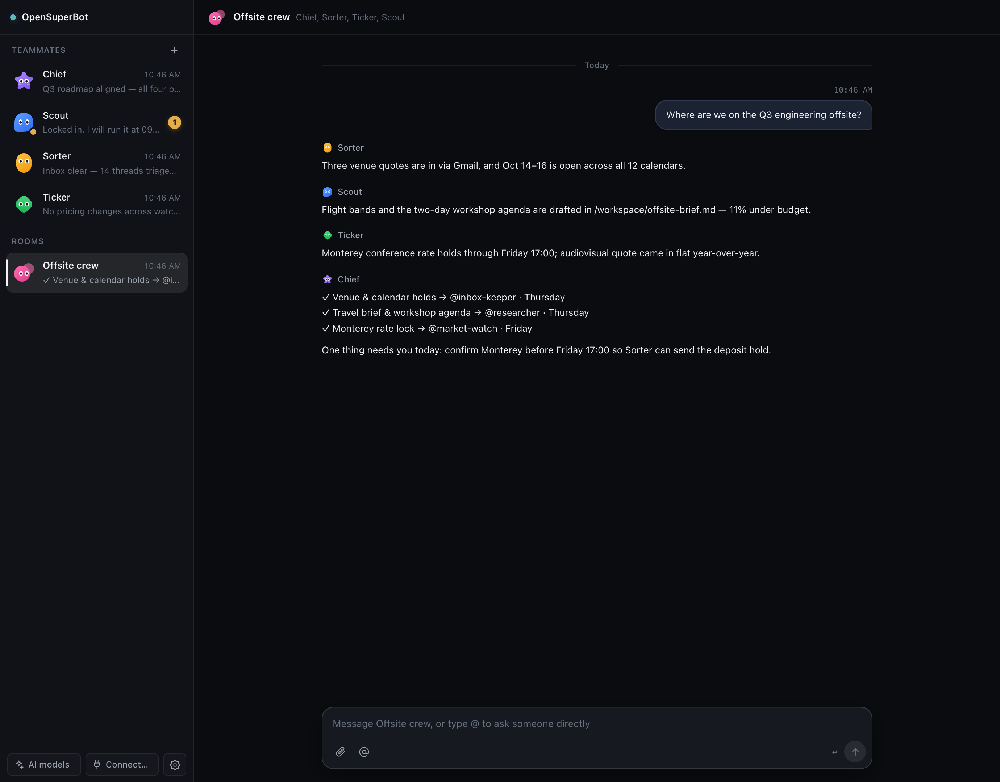
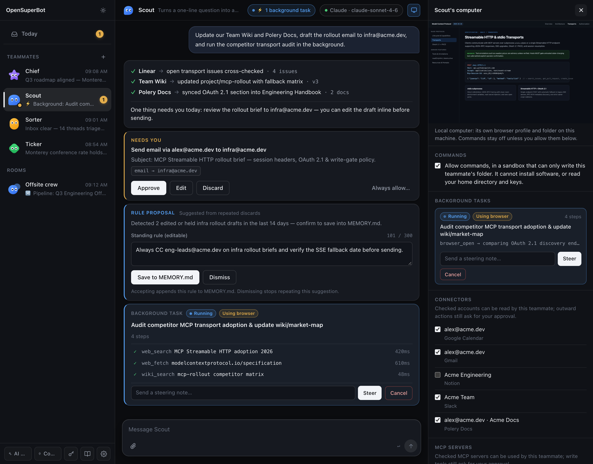
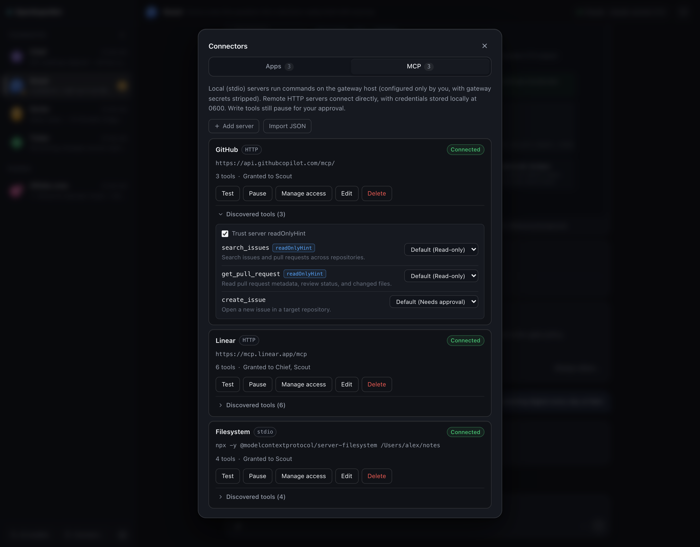
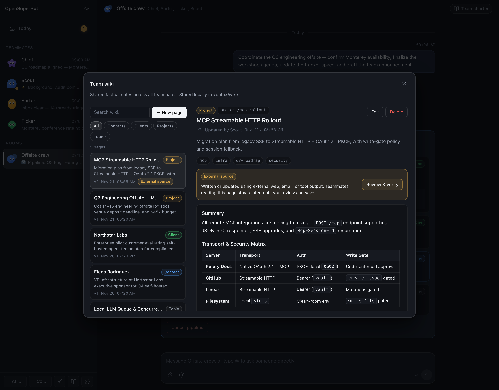
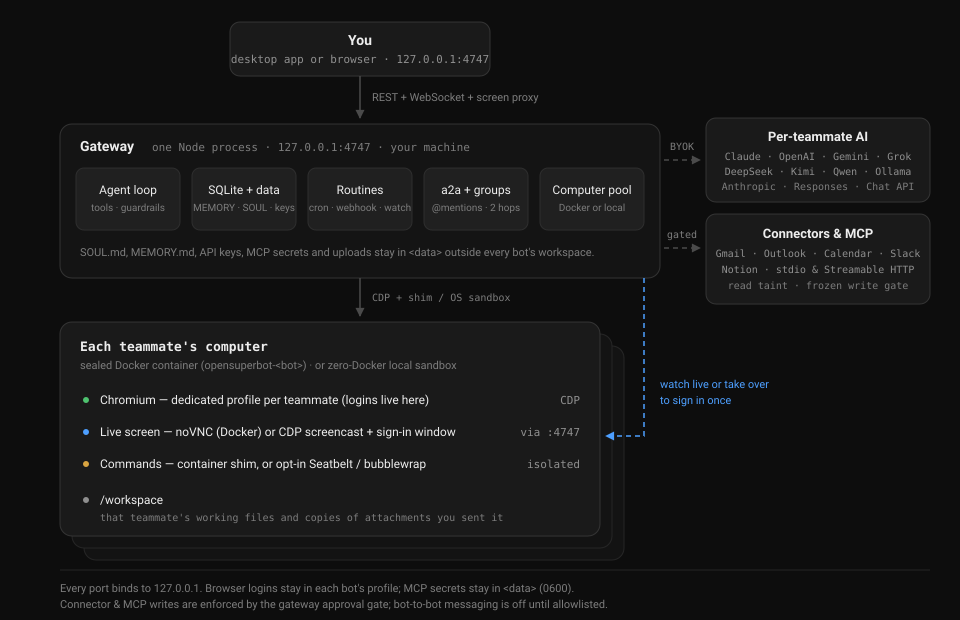

# OpenSuperBot 🦞🤖

> 一支随时在线的 AI 同事班子，**每个人一台自己的电脑**——跑在你自己的机器上，凭证在你自己手里。

*原名 OpenGrokBot。已经装过的直接升级，什么都不会坏，细节见
[Coming from OpenGrokBot](docs/always-on.md#coming-from-opengrokbot)。*

[English](README.md) · [中文](README.zh-CN.md)

[](LICENSE)
[](https://github.com/wolfqing/OpenSuperBot/actions/workflows/ci.yml)
[](https://github.com/wolfqing/OpenSuperBot/releases/latest)
[](docs/desktop.md)
[](docs/security.md)
[](docs/security.md)
[](../../pulls)

xAI 的 Grok Bot 卖的是「随时在线的同事」：每个 bot 配一台云电脑（浏览器、文件系统、终端），有持久记忆，彼此
能交接工作，还有一个 iMessage 形状的 app 来管他们。它跟着 Grok 和 Cursor 的付费订阅走，**用量另外计费**，而且
每个 bot 都跑在 xAI 的云上，**你的登录态也一起在里面**。

这个仓库是同样的形状，自托管版：你机器上一个 gateway 进程、每个 bot 一台自己的电脑（一个 Docker 容器；没有
Docker 时，就是你 Mac、Linux 或 Windows 机器上它自己的浏览器和文件夹）、桌面 App 或信息密度很高、更像工作台的网页客户端，每位同事
后面接你选的模型：Claude、OpenAI、Gemini、Grok、DeepSeek、Kimi、通义、智谱、MiniMax、本地 Ollama，或任何
OpenAI 兼容的模型。



<table>
<tr>
<td width="33%"></td>
<td width="33%"></td>
<td width="33%"></td>
</tr>
<tr>
<td><strong>今日 · 网络动态</strong>（浅色主题）——prompt 驱动后台联网追踪、直达原文来源，顶栏串联动态 / 灵感 / 待办与目标 / 空间。</td>
<td><strong>今日 · 实时空间</strong>（浅色主题）——零 JS 指标卡、图表、表格与快捷同事动作，按同事配置 <code>viewer</code> / <code>editor</code> 权限。</td>
<td><strong>群聊 · DAG 调度管线</strong>——共享 <code>team.md</code> 团队章程，支持多阶段并行推进、查看上游产出与遇审批自动暂停续跑。</td>
</tr>
<tr>
<td width="33%"></td>
<td width="33%"></td>
<td width="33%"></td>
</tr>
<tr>
<td><strong>电脑面板</strong>——可接管实时屏幕、沙箱命令行开关、运行中后台任务纠偏，以及连接器 / MCP / 凭证库 / 空间授权。</td>
<td><strong>连接器与 MCP</strong>——原生 OAuth 2.1 <strong>Polery 文档</strong>（免 Composio key）、Gmail / 日历 / Notion / Slack，加 <code>stdio</code> / <code>Streamable HTTP</code> MCP。</td>
<td><strong>团队知识库（Team Wiki）</strong>——零向量库实体页面（<code>project</code> / <code>client</code> / <code>contact</code> / <code>topic</code>），带 FTS5 检索、修订历史与外部来源核验。</td>
</tr>
</table>

## 这里的「同事」到底是什么

一个文件夹（`SOUL.md` 写它是谁，`AGENTS.md` 写它怎么干活、硬边界在哪）、侧栏里的一条线程，外加一台自己的电脑。
用 Docker 时，这台电脑是一个容器：



不用 Docker 时，换成一台「本机电脑」：你机器上一个在后台运行、有独立 profile 的浏览器，加上它自己的文件夹（见
[docs/local-computers.md](docs/local-computers.md)）。两种情况下，凭证都只存在**它的**浏览器 profile 里。gateway
看不到密码，配置文件里也不会有。

## 现在已经能做什么

下面每一条都已实现且有测试覆盖，没有一条是路线图。

**管理界面**

- **侧栏即组织架构。** 每个同事一条线程，外加群线程。预览显示的是完成态，扫一眼列表等于巡一遍工位。每位同事
  有一张自己的脸——一个带眼睛的彩色小形状——并且把它正在做的事演出来：干活时一颠一颠，等你时朝你蹦两下，卡住了
  摇头，在你看别处时干完了就笑。琥珀色徽章标出等你拍板的审批和问题数，浏览器标签页
  标题带着总数。
- **统一的汇报语法。** 干完的活以 `✓ 系统 → 结果 · 数字` 回来，最后一句人话只说需要你决定的事。所有同事同一种
  格式。
- **默认扣住且支持内联改草稿的审批链（含本地高危动作确定性护栏）。** 任何要出门或不可逆的动作都停在门口：不仅连接器写操作、MCP 写工具与保险箱填表由网关强制冻结，连高危 `shell` 命令（破坏性删除、敏感凭证目录读取、外传上传、强推历史、提权变更）与敏感浏览器提交（结账支付、永久删除、公开发送）也会被确定性护栏自动拦下，冻结进 `approvals.execution_json`（浏览器动作绑定 `expectedOrigin` 防跨站漂移）。chip 写清会做什么，支持**直接在审批卡片内修改草稿或命令参数**后再点 Approve 单次直执，或点
  Discard 驳回。在线程里发一个光秃秃的 👍 就放行最新那条。决议是幂等的——重复点击拿到 409，而不是发第二遍。同一个
  动作要发给很多人时，chip 会把每个对象列出来、各带一个勾：取消勾选几项，同事就只做剩下的。
- **由你划定的「以后都放行」。** 发给同一个去向的邮件、消息或帖子，可以点「Always allow…」：这次放行，之后
  这位同事再发同样的东西不用再问——一小时、一天，或直到你在电脑面板里撤销。花钱、预订、高危护栏动作和说不清是什么的动作永远
  要问。
- **点一下就能回答的问题。** 下一步是几个明确选项之一时，同事会贴一张带按钮的问题卡片，而不是列一大段选项，
  然后等你选。
- **看得见的记忆与对话反馈受控学习（Conversational Dreaming）。** 「以后安静客户的邮件等我读过再发」会把这条规矩写进那个 bot 的 `MEMORY.md`，并把
  diff 作为 chip 贴出来；「忘掉那条规矩」用同样的方式删掉它，电脑面板也列出全部规矩、每条都能删。这个文件放在 bot
  的电脑之外，所以每次改动都有一张 chip。无论同一类动作 14 天内被驳回 ≥ 2 次、你在主动消息后连续抱怨打扰方式（两级线索池累积满 2 次或明确说出常设偏好），还是同事调用 `propose_memory_rule`，系统都绝不
  越权静默改写 `MEMORY.md`，而是弹出一张可编辑的**规矩提议卡片**（存入 / 忽略），含外部内容时单调保留琥珀色警示。
- **统一「今日」工作台（动态、灵感、待办与目标、空间）。** 在所有同事之上提供每日总览：
  - *持续自定义网络动态（Feed）：* 用 prompt 定义关心的主题，后台通过安全只读的 `web_search` / `web_fetch` 持续从网络
    抓取动态（非 cron 定时任务），带 7 天标题/链接去重、每日约 15 条上限，每条卡片可直达原文来源。
  - *自动整理的灵感、待办与目标：* 从你的对话上下文自动提炼灵感、可勾选待办（To-dos）与多阶段目标/里程碑（带模糊去重、
    污点保留与一键回跳来源线程），并与「等你处理」的审批/提问/登录接管及追踪例行任务统一汇集在**待办与目标**中。
  - *声明式实时空间（Live Spaces）：* 零 JS 的结构化看板（`metric`、`table`、`kanban`、`timeline`、`chart`、
    `markdown`、`actions`），支持按同事授予 `viewer` / `editor` 权限与对话内实时卡片更新。
- **本地凭证保险箱（Vault）。** 将 API 密钥、站点登录凭据与 TOTP（2FA）种子单独保存在本机 `<数据目录>/vault-secrets.json`
  （权限 `0600`，绝不进 SQLite、容器或模型提示词），支持严格 HTTPS 域名白名单、按同事零默认授权、MCP 配置中的
  `${vault:<slug>.<field>}` 引用、带污点/审批门控的 `vault_fill` 自动填表与输出自动脱敏。
- **团队共享实体知识库（Team Wiki）。** 零向量库依赖，基于 SQLite FTS5 + 中英双语分词 + 多查询 RRF × 时间衰减：
  `wiki_search` 一搜同返「Wiki 实体页」与当前同事可访问的「原始对话记录」双榜；支持按段增量修订 `wiki_patch`（保留未改条目与 `[#msg:<id>]` 引用，由网关确定性追加 `## Change Log`）、后台 `P3` 低优自动从闲置对话沉淀词条（及手动一键同步）、原子同步 `<数据目录>/wiki/`
  Markdown 镜像、修订历史与跨同事 `outside-data` 污点核验。
- **例行任务、`prepare` 备料模式、免打扰晨报与三维提醒防抖。** 一句话注册 cron 定时任务或带密钥的 webhook 触发器；除全功能 `act`
  与只读静默 `watch` 外，支持 **`prepare` 备料模式**（只读工具 + `wiki_upsert` / `wiki_patch` + 工作区 `write_file`，禁止命令行、
  网页点击和对外写入，无需备料时保持安静）。内置**三维主动投递节奏控制**（60 秒多事件 Webhook 合并、正在聊天时静默暂缓 3 分钟再补发、单同事每日 5 条非紧急提醒上限超额自动转入今日动态/晨报）与**免打扰时段（Quiet Hours）**晨报汇总，而紧急告警（`urgent: true`）、审批、提问与手动运行始终即时送达。
- **前后台分身（Meta / AlterEgo 后台任务）。** 耗时多步调研或整理可交给同事的后台任务通道
  （`delegate_background_task`），前台对话立刻恢复空闲可继续聊天；随时通过卡片或电脑面板查看实时步骤、发送**纠偏指令**
  或取消任务，单同事浏览器租约锁确保前后台绝不互相覆盖页面。
- **本地模型优先级信号量队列。** 多位同事共享本地端点（Ollama、`localhost` 或局域网）时，按 `P0 交互 > P1 后台 > P2 定时 > P3 低优`
  在步骤间插队，避免本地显存/内存争抢，云端 API 零开销旁路（可在「设置 → 本地模型并发上限」调整）。
- **长会话上下文护栏、联想式历史召回（Flashback）与一键脱敏诊断包。** 自动推断模型上下文窗口并在回合内裁剪旧工具结果、按 `(线程, 同事)` 生成检查点压缩、
  超大工具输出落盘工作区、重复调用循环保护、隔离式历史检索（`search_history`），以及零额外 LLM 延迟的**联想式历史召回（Flashback）**——回合前自动围绕实义词召回未污染 Wiki 与窗口外过往决策（带 15 分钟/4 轮与 24 小时双层防唠叨冷却，尾部临时只读围栏注入不破坏 KV 缓存前缀）。在「设置 → 关于」支持一键复制或下载全谱系密钥与用户名自动脱敏的诊断包（零聊天/文档正文采集）。
- **深浅主题切换与一键设为默认模型。** 支持深色、浅色与跟随系统外观，并可在「AI 模型」中一键切换全局默认连接。
- **录下来的操作轨迹与确定性回放。** API 支持在同事已有的浏览器页面上录制带类型的操作步骤（密码、一次性验证码等敏感输
  入框自动打码），并可带占位参数与审批步骤确定性回放已存轨迹。本机电脑上的录制在窗口重开后会接着录；可视化入口与例行任
  务接入单独跟进。见 [docs/workflows.md](docs/workflows.md)。
- **把文件交给它。** 发消息时可以带上图片、PDF、文本或 Markdown 文件：点回形针、粘贴、拖进对话都行。文件会放进这位同事自己的文件夹，
  它打得开；能看图的模型会直接看到图片；PDF 会连同抽好的文字一起送到，它读得了。详见 [docs/attachments.md](docs/attachments.md)。
- **共享技能（内置预置 + 自由扩展）。** 开箱自带 6 份高频办公与调研手册（`meeting-minutes` 会议纪要、`research-brief` 多源调研简报、
  `spreadsheet-analysis` 表格脚本分析、`doc-drafting` 结构化起草、`slide-outline` 幻灯片大纲、`careful-browsing` 稳健网页操作）；
  往 `<数据目录>/skills/` 放一份 Markdown 做事手册即可新增自定义技能，或同名覆盖内置版本且升级不丢。记忆和 routine 各归各，技能大家共用。
- **看得见在干什么，也停得下来。** 它在电脑上的每一步——跑的命令、开的网页、点的按钮——实时显示在一张卡片里，
  回合结束后折叠成一行。停止按钮随时结束这一轮。每一个动作还会记进日志，连同是谁让它开始的，在电脑面板里能看。
- **想要的话，还有预算。** `OPENSUPERBOT_DAILY_TOKENS` 给每位同事设每日 token 上限，面板里能看到今天用了多少。

**电脑**

- 在它自己的工作区里 `read_file`、`write_file`、`shell`：容器里，或者本机电脑上一个任何路径都出不去的文件夹。
  本机电脑的命令行默认关着，你给那位同事打开后，命令跑在系统沙箱里（macOS 用 Seatbelt，Linux 用 bubblewrap）。
  长文件、长网页分片读，不再被悄悄截断。
- `browser_goto` / `browser_extract`（附页面上的链接）/ `browser_click` / `browser_type` / `browser_press` /
  `browser_scroll` / `browser_back` 操作真正的 Chromium——登录墙后面的站点和表单都能干，这是纯 API/MCP
  方案做不到的。容器镜像里装好了中文和 emoji 字体。
- `browser_screenshot` 把它看到的画面贴进聊天当证据；开 `OPENSUPERBOT_VISION=1` 后也会给支持看图的模型看。
- **接管登录。** 撞上登录墙时，bot 调 `ask_for_login` 而不是问你要密码。你在**它的**浏览器里登录一次——容器的话
  从线程里打开它的屏幕；本机电脑的话，它的浏览器会以普通窗口弹到你桌面上——会话就留在它的 profile 里，重启也还在。
- 电脑按需启动，闲置一小时自动停机，下次用时连同登录态原样回来。容器有内存 / CPU / 进程数上限，也碰不到别的同事
  的电脑；本机电脑没有资源上限（[这意味着什么](docs/security.md#local-computers)）。

**应用连接器与标准 MCP 客户端**

- **原生 Polery 文档连接器（`polery`）。** 直接在「连接器 → 应用」内通过第一方 OAuth 2.1（PKCE S256 + RFC 8707
  `resource` 绑定）与 Streamable HTTP MCP 接入 Polery 文档——**无需 Composio API key**。提供 4 个只读工具
  （`polery_list_documents`、`polery_search_documents`、`polery_read_document`、`polery_get_proposal`）与 2 个
  需审批的写入工具（`polery_create_document`、`polery_propose_edits`），令牌加密隔离存在本机
  `<数据目录>/polery-tokens.json`（权限 `0600`）。
- **应用连接器（Gmail、Outlook、Google 与 Outlook 日历、Notion、Slack）。** 在「连接器 → 应用」里通过 Composio OAuth
  绑定一个或多个账号，并按同事勾选授权。内置 16 个结构化工具、三阶邮件去噪防追踪清洗（过滤 `no-reply` / `mailer-daemon`
  机器通知、剥离 HTML 与隐藏追踪像素、剔除链接追踪参数）、读取 `outside-data` 染色，以及**网关代码强制执行的冻结审批**
  （你点 Approve 后由网关单次执行真实冻结参数，中途断连绝不自动重发）。
- **零依赖原生 MCP 客户端（`stdio` 与 `Streamable HTTP`）。** 在「连接器 → MCP」里接入任意 Model Context Protocol
  服务——本机 `stdio` 命令（`shell: false` 净室环境变量）或远程 `Streamable HTTP` 端点（自动回退 `2024-11-05` HTTP+SSE，
  带同源重定向防护）——也可直接粘贴 Claude Desktop / Cursor 的 `mcpServers` JSON 一键批量导入。支持大工具集按需加载
  与 `${vault:<slug>.<field>}` 保险箱引用；密钥只存在本机 `<数据目录>/mcp-secrets.json`（权限 `0600`），不进数据库和容器；
  按同事显式授权；工具默认按 `'write'` 拦截，`'read'` 工具可在 `watch` 巡检中安全运行，`'write'` 工具统一挂起审批且禁止自动记住放行。

**这支班子**

- **群线程、团队章程（`team.md`）与 DAG 协作流水线。** 在群里可编辑由你独享维护的**团队章程（`team.md`）**，自动注入
  每位群内同事的提示词；问一句时每位同事并行答复自己那摊，幕僚长收口发分派表（`✓ 事项 → @bot · 期限`），或在遇到有依赖
  关系的跨同事项目时生成可视化的**协作流水线卡片**（`create_dispatch_plan`）。点「启动执行」后，无依赖阶段并行推进，
  下游自动收到带哈希围栏与污点传递的上游产出，遇审批或提问自动暂停、批完继续。打 `@` 点名则只叫被点到的同事。
- **走白名单的交接。** `message_bot` 把一件划好范围的活丢进另一位同事的线程并叫醒他。默认只有幕僚长能联系所有
  人，同级互发要显式指定方向。转发最多两跳，两个 bot 不会互相回声。
- **从侧栏雇人。** 点 `+`、填个名字（中文也行）、一句职位描述。没有工作流编辑器，没有工具勾选清单——复杂度积累
  在使用过程中，而不是前置在表单里。

## 快速开始

### 下载桌面版（macOS 与 Linux）

直接从 **[GitHub Releases](https://github.com/wolfqing/OpenSuperBot/releases/latest)** 下载对应安装包：macOS Apple
芯片选 `mac-arm64.dmg`、Intel 选 `mac-x64.dmg`；Ubuntu / Debian 选 `linux-amd64.deb` 或 `linux-arm64.deb`；其他 Linux
发行版选 `linux-x86_64.AppImage` 或 `linux-arm64.AppImage`。不需要装 Node、pnpm、Docker，也不用碰终端：打开后跟着向导选语言、
粘贴一家模型的 key（或零 key 点「先看看」进演示模式）、检查浏览器与沙箱，就能进对话派活。

首次打开说明：

- **macOS：** 首版安装包采用本地 ad-hoc 签名，尚未做 Apple 开发者公证。请先把 **OpenSuperBot** 拖进「应用程序」再打开；
  第一次弹出「未打开“OpenSuperBot”」时点**完成**（不要点移到废纸篓），再去**系统设置 → 隐私与安全性**底部点**仍要打开**即可。
- **Ubuntu 24.04+：** 请优先安装 `.deb` 包——它会自动装好 `bubblewrap` 与对应的 AppArmor 规则，让命令行沙箱开箱可用。

带截图的完整步骤、启动更新检查说明（仅发一次 GitHub 请求、不自动更新、可在设置里关闭）、数据目录与干净卸载方式见
[docs/desktop.md](docs/desktop.md)。

### 从源码运行

适合 Windows（首版暂无桌面安装包）、服务器常驻或本地改代码。需要 Node 22+ 和 pnpm。**Docker 可选。** 不装 Docker，每位同事得到一台「本机电脑」：在你机器上有它自己的浏览器
（有 Chrome / Edge / Chromium 就直接用，没有就自动下载一次）和自己的文件夹；Docker 开着时，每位同事得到一个
封闭的容器。本机电脑支持 macOS、Linux 和 Windows；Windows 上它有浏览器和文件夹，但没有命令行——在 Windows 上需要
命令行的同事，请给它一台 Docker 电脑。

```bash
git clone https://github.com/wolfqing/OpenSuperBot.git
cd OpenSuperBot
pnpm install
```

不用任何 API key 就能试——内置的脚本化假模型能把每条链路都跑通：

```bash
OPENSUPERBOT_MODEL=stub pnpm dev
```

Windows 上在 PowerShell 里：`$env:OPENSUPERBOT_MODEL = 'stub'; pnpm dev`。

gateway 启动时会打印一条登录链接——`http://localhost:5173/auth?token=…`。每个浏览器打开一次即可；没有这个
令牌，什么都连不上 gateway。

接真模型：不设任何模型变量，直接 `pnpm dev`，第一次打开的页面就是设置向导——选一家服务、粘贴 key、测试、选模型；
key 存在这台机器上，不用 export 什么。向导还会检查浏览器、Docker 和沙箱，前几步都能一键进演示模式。

也可以用环境变量配，这样不出向导（任何 OpenAI 兼容的都行：xAI、Kimi、DeepSeek、本地 Ollama）：

```bash
OPENSUPERBOT_API_KEY=sk-… OPENSUPERBOT_MODEL=grok-4.7 pnpm dev
```

（PowerShell：`$env:OPENSUPERBOT_API_KEY = 'sk-…'; $env:OPENSUPERBOT_MODEL = 'grok-4.7'; pnpm dev`。）

想让不同同事用不同的模型：点侧栏底部的 **AI 模型**，每家有 key 的服务加一个连接，再到同事对话的顶部给它选一个。
支持哪些服务、该用哪种 key、哪些订阅不许别的应用用，见 [AI 模型](docs/models.md)。

gateway 启动时自己选电脑的种类并写进日志：Docker 守护进程应答、镜像也建好了就用 Docker，否则用本机模式
（`OPENSUPERBOT_COMPUTERS=docker|local` 可以强制）。用 Docker 要先建镜像：`docker build -t opensuperbot/bot:dev docker/bot`。
本机电脑上**命令行默认关着**，在那位同事的电脑面板里按需打开；打开后命令跑在系统沙箱里（macOS 用 Seatbelt，
Linux 用 bubblewrap），只能写这位同事自己的文件夹。Windows 没有同样可靠的沙箱，那里这个开关一直关着。
细节见 [docs/local-computers.md](docs/local-computers.md)。

想让它常驻——一个进程、一个端口、开机自启、经隧道远程访问——用 `pnpm build && pnpm start`，以及
[docs/always-on.md](docs/always-on.md) 里的 launchd / systemd / Windows 计划任务模板。

| 环境变量 | 默认值 | 作用 |
|---|---|---|
| `OPENSUPERBOT_API_BASE` | `https://api.x.ai/v1` | 任何 OpenAI 兼容端点 |
| `OPENSUPERBOT_API_KEY` | — | 你的 key。环境变量给的 key 只留在内存里、绝不写盘；在向导或「AI 模型」里保存的 key 存进 `<数据目录>/llm-key` 和 `<数据目录>/llm-keys/`（权限 `0600`，Windows 上设为仅当前用户可读的 ACL） |
| `OPENSUPERBOT_MODEL` | `grok-4.7` | 填 `stub` 可离线零 key 运行 |
| `OPENSUPERBOT_DATA` | `gateway/data` | SQLite、bot 数据、工作区、gateway 令牌 |
| `OPENSUPERBOT_COMPUTERS` | `auto` | `docker`、`local`，或 `auto`（Docker 在跑、镜像建好了就用 Docker，否则本机） |
| `OPENSUPERBOT_BROWSER` | *(自动找)* | 本机电脑用的浏览器；不填就找 Chrome / Edge / Chromium，都没有就下载一个 |
| `OPENSUPERBOT_BROWSER_MIRROR` | *(官方)* | 下载那个浏览器用的镜像主机，国内网络用 |
| `OPENSUPERBOT_A2A_ALLOW` | *(空)* | 同级交接，如 `researcher>market-watch` |
| `OPENSUPERBOT_DAILY_TOKENS` | `0`（不限） | 每位同事每天的 token 预算 |
| `OPENSUPERBOT_VISION` | *(关)* | 把截图喂回给模型看 |
| `OPENSUPERBOT_UPLOADS_MAX_MB` | `2048` | 你发给同事的文件总共最多占多少磁盘；`0` 不限 |
| `OPENSUPERBOT_COMPOSIO_API_KEY` | — | 「连接器 → 应用」可选的 Composio API key；界面保存的 key 存进 `<数据目录>/composio-key`（权限 `0600`） |
| `OPENSUPERBOT_POLERY_ORIGIN` | `https://docs.polery.com` | 可选，自定义原生 Polery 文档 OAuth/MCP 连接器的服务地址 |
| `OPENSUPERBOT_LOCAL_LLM_CONCURRENCY` | `1` | 本地模型端点（`localhost` / Ollama / 局域网）在 `P0–P3` 优先级队列下的最大并发数 |
| `OPENSUPERBOT_CONTEXT_WINDOW` | `0`（自动） | 可选，覆盖上下文窗口预算与检查点压缩阈值（为 `0` 时按模型家族自动推断） |

其余设置——监听地址、闲置停机、单台电脑的资源上限、超时——见
[docs/always-on.md](docs/always-on.md#configuration)。

国内网络：用 Docker 的话挂镜像源构建——`docker build --build-arg APT_MIRROR=mirrors.aliyun.com …`（某个源不稳就换
`mirrors.huaweicloud.com` 或 `mirrors.tuna.tsinghua.edu.cn`；apt 会自动重试，单个包最多等 5 分钟）；本机电脑需要
下载浏览器的话，设 `OPENSUPERBOT_BROWSER_MIRROR=https://cdn.npmmirror.com/binaries/playwright`。

## 安全不是脚注，是全部理由

对「托管式常驻 agent」最响的反对声：一个永不休眠、手握你全部凭证的 agent，跑在别人的基础设施上，还暴露在提示词
注入面前。自托管的回答是：

- **凭证隔离在 bot 触及不到的地方。** 浏览器登录态只留在每个 bot 自己的浏览器 profile 里；Vault 保险箱明文、MCP 密钥与
  原生 Polery OAuth 令牌只存在你机器上的 `<数据目录>/vault-secrets.json`、`<数据目录>/mcp-secrets.json` 和
  `<数据目录>/polery-tokens.json`（权限 `0600`，绝不进 SQLite、容器或模型提示词，且 `vault_fill` 强制执行 HTTPS 域名白名单
  与输出脱敏）；如果启用 Composio 应用连接器，OAuth 令牌由 Composio 托管，API key 则留在 `<数据目录>/composio-key`
  （`0600`），绝不挂进任何 bot 容器或工作区。
- **bot 不会在聊天里问密码。** 它只会请你接管它的屏幕。
- **没有令牌，什么都连不上 gateway。** 它只听 `127.0.0.1`，校验 `Host` 请求头防 DNS 重绑定并拦截跨站 `Sec-Fetch-Site`
  请求，每个浏览器登录一次，且只有它自己的页面能改状态。你随手打开的网页放行不了审批——bot 自己也放行不了。
- **每个 bot 各在各的笼子里**——独立容器、独立工作区、资源上限，而且没有通往别的同事电脑的路。本机电脑的笼子
  薄一些：文件出不了它的文件夹，命令行要你打开才有，但内存和 CPU 没有上限，它跑的命令也能访问你的网络。差别在
  [docs/security.md](docs/security.md#local-computers) 里写清楚了。
- **规矩只能经记忆 chip 改。** bot 没法悄悄改写你交代过的话。
- **对外动作会扣住等你批准。** 应用连接器写操作、MCP 写工具和录制工作流的审批步骤均由 **gateway 代码级强制拦截**——
  参数先冻结，等你点 Approve 后才由网关执行。普通浏览器点击与命令行外发仍属提示词约定，所以浏览器里请给 bot 配它们
  自己的账号，别用你的。
- **bot 之间默认不能互发消息**，要你显式放行方向。

哪些是代码强制的、哪些只是约定、哪些仍然要你自己把关，[docs/security.md](docs/security.md) 里写得清清楚楚。

## 成本

| | Grok Bot | OpenSuperBot |
|---|---|---|
| 软件 | 需要 SuperGrok 或 Cursor 付费订阅，用量另计 | $0（一路 MIT） |
| 算力 | 含（xAI 的云） | 你现有的 Mac / 小主机 / ~$5 VPS |
| 模型 | 含（只有 Grok） | 你自己的 key，任意厂商——本地模型则 $0 |
| 你的登录态 | 在 xAI 云上 | 在你机器上、每个 bot 自己的浏览器 profile 里 |

说句公道话：Grok Bot 的开箱即用、iOS app、看着你操作就学会，这三样是真优势。如果你不介意把账号放在 xAI 云上，
也愿意为省事付钱，那就买它。这个仓库是给那些对「你能接受吗？」回答**不能**的人准备的。

## 姊妹项目：Grok Desktop

OpenSuperBot 管的是你不在电脑前时发生的工作。你自己泡在 Grok 里的那些时间，可以用
**[Grok Desktop](https://github.com/wolfqing/GrokDesktop)**：macOS 14+ 的原生 SwiftUI 窗口，Chat 内嵌 grok.com，
Build 驱动你本机的 `grok` 命令行——会话按项目分组，Markdown、计划、diff、实时终端都在右侧检查器里，Imagine
也不用离开窗口。免费、社区作品、非 xAI 官方产品。[下载最新版本](https://github.com/wolfqing/GrokDesktop/releases/latest)。

## 路线图

- [ ] **teach-mode**——录一遍浏览器操作，存成一个同事能反复执行的 workflow，手动跑或由 routine 定时跑。类型化浏览器录制器与确定性回放（见 [docs/workflows.md](docs/workflows.md)）已合入；可视化操作入口与例行任务接入跟进在 [#1](../../issues/1)
- [x] **不用 Docker 的电脑**（macOS 和 Linux）——每位同事独立的浏览器 profile 和文件夹，命令行默认关、打开后跑在
      系统沙箱里（v0.4.0）；Windows 上有浏览器和文件夹
- [x] **带首次启动向导的桌面 App**（macOS 和 Linux）——试用不需要 Docker、Node 和终端，支持菜单栏/托盘常驻、开机自启与
      中英双语界面（v0.6.0，见 [docs/desktop.md](docs/desktop.md)）
- [x] **应用连接器与原生 MCP 客户端**——支持 Gmail、Outlook、Google 与 Outlook 日历、Notion、Slack 多账号 OAuth 接入，以及零依赖 `stdio` / `Streamable HTTP` MCP 服务、Claude Desktop / Cursor JSON 批量导入、按同事显式授权与网关代码级冻结写操作审批（v0.7.0，见 [docs/security.md](docs/security.md)）
- [x] **主动式团队协作、后台任务与 DAG 调度管线**——审批卡片内联改草稿、零向量库**团队共享知识库（Team Wiki）**（SQLite FTS5 + RRF + 修订历史 + 外部来源核验）、免打扰晨报与 `prepare` 备料模式、受控学习规矩提议、本地模型 `P0–P3` 优先级信号量队列、带浏览器租约锁的可纠偏后台任务（Meta / AlterEgo），以及群聊 `team.md` 团队章程与多阶段 DAG 协作流水线（v0.8.0）
- [x] **统一「今日」工作台、凭证库、原生 Polery 文档与长会话上下文护栏**——持续自定义网络 **Feed**、对话自动整理的**灵感 / 待办 / 目标**、零 JS 声明式**实时空间（Live Spaces）**、本机 `0600` **凭证保险箱（Vault）**（TOTP + HTTPS 域名白名单 + `${vault:...}` 引用）、原生 OAuth 2.1 **Polery 文档**、深浅主题切换，以及自动上下文窗口压缩、大结果落盘、循环保护与 FTS5 历史检索（v0.8.1）
- [ ] **macOS 26 上的 Apple container 后端**（免 Docker 的轻量虚拟机隔离）与 Windows 桌面安装包。计划见
      [docs/local-computers.md](docs/local-computers.md)
- [ ] Telegram 作为离开电脑时的通知 / 审批补位渠道
- [ ] 一条命令起 VPS 镜像（cloud-init）

## 常见问题

**和 Grok Bot 是什么关系？** 同一件事——常驻同事、各自的电脑、持久记忆、互相交接——但托管模型相反，且**零共享
代码**（Grok Bot 闭源，根本无从 fork）。它甚至可以用同一个大脑：把 API 指向 Grok 即可。

**和 OpenClaw 是什么关系？** 本仓库 v0.1 是 OpenClaw 之上的一个发行版。v0.2 换成了自研核，因为「每个同事一台
自己的电脑」和 OpenClaw 的共享主机模型是拧着的。旧配方保留在
[docs/openclaw-recipe/](docs/openclaw-recipe/README.md)。本项目不是 OpenClaw 官方项目。

**必须用 Docker 吗？** 不必。在 macOS、Linux 和 Windows 上，没有 Docker 时每位同事得到一台本机电脑：你机器上它
自己的浏览器和文件夹。Docker 换来的是更强的隔离（每位同事一个容器，带资源上限）；在 Windows 上，目前仍然只有
Docker 能给同事命令行。见 [docs/local-computers.md](docs/local-computers.md)。

更多见 [docs/desktop.md](docs/desktop.md) · [docs/models.md](docs/models.md) · [docs/faq.md](docs/faq.md) ·
[docs/multi-bot.md](docs/multi-bot.md) · [docs/attachments.md](docs/attachments.md) · [docs/always-on.md](docs/always-on.md) ·
[docs/security.md](docs/security.md) · [docs/workflows.md](docs/workflows.md) · [docs/comparison.md](docs/comparison.md) ·
[CHANGELOG.md](CHANGELOG.md)

## 免责声明

非官方项目，与 xAI 或 OpenClaw Foundation 无任何隶属、背书或关联关系。"Grok" 是 xAI 的商标，此处仅用于指明本项目
所对标的产品。

## License

[MIT](LICENSE)。觉得有用就点个 star。⭐
